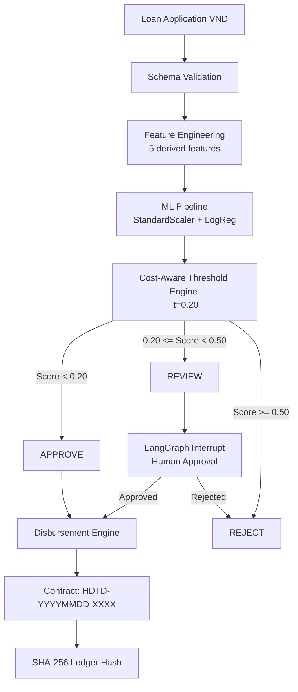

# 🏦 CreditFlow — ML Credit Risk Decision Engine

> **Interview release:** [five-minute demo, evidence, and production boundaries](docs/INTERVIEW_RELEASE.md) · [portfolio pack](../PORTFOLIO_INTERVIEW.md)

[](https://python.org)
[](https://fastapi.tiangolo.com)
[](https://reactjs.org/)
[](https://xgboost.readthedocs.io/)
[](https://scikit-learn.org/)
[](https://mlflow.org/)
[](https://www.docker.com/)
[]()
[](LICENSE)

**CreditFlow** is a credit risk decision-support prototype with a path toward controlled bank deployment. It covers **data validation → feature engineering → model training → evaluation → serving → monitoring**. The current model uses synthetic data and has not been validated for real lending.

Designed with enterprise requirements in mind, it features tamper-evident audit trails, human-in-the-loop approval workflows, explainability, cryptographic decision snapshots, and rigorous cost-sensitive model selection.

## 🚦 Deployment status (last external audit 2026-10-09)

**Enterprise transition in progress (2026-11-03):** `CREDITFLOW_ENV=production` now requires OIDC configuration and a machine API key at startup. Human routes accept only IdP-signed bearer tokens; the shared key is reserved for the scheduled monitoring job. The public portfolio frontend remains a synthetic demo and is not an authenticated bank staff portal. No real lending decision or payment rail is approved. Revalidate deployment URLs after these changes; the table below is historical evidence only.

| Component | URL | State |
|---|---|---|
| Frontend (GitHub Pages) | https://imtarget05.github.io/CreditFlow/ | Serves the CreditFlow app shell, but the live bundle still targets the Render mirror and business calls are not verified. The revised `cd.yml` will rebuild against Azure after successful CI and Azure gate. `creditflow.pages.dev` serves unrelated content and must not be used. |
| API (Azure Container Apps) | https://creditflow-api.proudstone-70150af3.southeastasia.azurecontainerapps.io | `creditflow-api` container app, scale 0-1; FQDN rechecked 2026-11-04 (read-only). Business readiness is not verified. |
| API + Postgres (Render mirror, DB on Neon) | https://creditflow-api-9z1v.onrender.com | Mirror plane from `render.yaml` (Docker web + Neon Postgres via `DATABASE_URL`, set in the Render dashboard), autoDeploy on push |

Owner actions (dashboards — pipeline code is ready):

- Azure: confirm the `creditflow-api` Container App is deployed and the API key has
  been rotated after removing the old key from the Pages bundle; use the Azure
  dashboard to check health and environment configuration.
- GitHub: configure `AZURE_CREDENTIALS` and `CREDITFLOW_API_KEY` as Actions secrets
  for API deployment only. The key is sent to Azure as an ACA secret and used by
  server-side smoke checks; it is never passed to the Pages build/browser bundle.
- Keep the Azure app's existing `CREDITFLOW_ENV` mode unchanged during this
  alignment; production mode intentionally disables simulated CIC/bank gateways
  and requires a separate real-gateway readiness decision.
- The public frontend can score applications, but ledger reads and human approval
  remain locked until a user-authenticated server-side flow is implemented. Do not
  put a shared key in this static frontend.

> **Current identity boundary:** OIDC token validation and group-to-role mapping are implemented, but no Sacombank IdP, group IDs, session UX, or access review has been connected or accepted. Local demo login requires explicit opt-in and configured hashed users. The bundled model uses synthetic proxy data; production readiness and scoring are blocked until independent model validation and a reviewed release. Production workflow, approval, document upload, and settlement also remain blocked pending bank integrations.

The [enterprise readiness report](docs/qa/ENTERPRISE_READINESS_2026-11-03.md) tracks open release gates; [Sacombank pilot inputs](docs/qa/SACOMBANK_INPUTS_FOR_PILOT.md) lists the process, policy, identity, data and sandbox artifacts needed from bank owners.

---

## ✨ Key Features & Engineering Decisions

1. **Business-Driven Model Selection**: Evaluated Logistic Regression, Decision Tree, Random Forest, and XGBoost. The model was selected based on a **custom business cost metric**, not raw accuracy. 
2. **Cost-Sensitive Threshold Tuning**: Optimized for asymmetric costs (False Negative cost=5.0 for missed defaults, False Positive cost=1.0 for wrong rejections), resulting in an optimal decision threshold of `0.20`.
3. **Winning Model**: **Logistic Regression** (Business Cost=201, Recall=0.80, F1=0.57) outperformed XGBoost on the business cost metric and was selected for production.
4. **Robust Feature Engineering**: Engineered 5 derived features (`debt_to_income`, `loan_to_income`, `debt_to_loan`, `employment_stability`, `credit_history_year_ratio`) with zero-division guards and robust handling of edge cases.
5. **Stateful Decision Workflow**: Leverages **LangGraph** for a 12-node state machine (load → gateways → validate → risk → financials → fraud → policy → explain → decision → [human_approval] → execute → audit) that handles human interrupts for `REVIEW` decisions, pausing and resuming workflows asynchronously.
6. **Core-Banking Ledger & Tamper-Evident Decision Snapshots**: Employs SQLite/Postgres ledger with deterministic contract codes (`HDTD-YYYYMMDD-XXXX`), document persistence with SHA-256 artifact verification, and **cryptographic decision snapshots** (`snapshot_hash` SHA-256 digest locking decision ID, application ID, decision, probability, reviewer, timestamp, and model bundle checksum).
7. **Anti-Double-Click Approval Idempotency**: HITL approval endpoint enforces atomic `PENDING_REVIEW` reservation and `idempotency_key` deduplication, preventing race conditions and replay submissions.
8. **Explainable AI**: Deployment duy nhất: **PRIVATE ON-PREM** — lõi Deterministic ML + Rule Engine nội bộ (Rule Filter DTI/LTI + TF-IDF cosine inference), LLM memo chạy Private vLLM nội bộ (Local VPC: `ollama`/`local_vllm`/`private-vllm`). **Policy Guard cứng: data `CONFIDENTIAL` tuyệt đối chặn, không fallback Public Cloud** (OpenAI/Groq/Cloudflare/Anthropic/Google). The LLM *explains*, it does *not* decide. Training = Traditional ML Training from Scratch (LogReg/XGBoost tabular, `colab/train_credit_T4.ipynb`).
9. **Production Monitoring & Drift Domain Events**: Includes **PSI (Population Stability Index)** drift detection against baselines; emits `ModelDriftDetected` domain events to the outbox when distribution shift exceeds threshold.
10. **Model Integrity Verification**: Load-time gate checks model bundle checksum against `SHA256SUMS` and `manifest.json`.
11. **Comprehensive MLOps & Cloud-Native Topology**: Experiment tracking via MLflow; containerized deployments with Kubernetes manifests (`k8s/20-creditflow-api.yaml`) featuring HPA and hardened security profiles (dev-stub manifest — not a live cluster).


---

## 🏗 Architecture

The system orchestrates the flow of a loan application through validation, feature engineering, ML scoring, policy rules, and final disbursement.



> **Note — `execute()` is a synthetic disbursement workflow.**
> The LangGraph node (`pipeline/agent/nodes.py`) generates VietQR and a loan
> agreement, then can initiate and approve a **simulated** core-banking transfer
> when a distinct checker is present. It does not move real money. Production
> scoring, approval and settlement remain blocked until bank contracts and
> independent acceptance are in place.

---

## 🛠 Tech Stack

| Category | Technologies |
|---|---|
| **Backend** | Python 3.12, FastAPI, Pydantic v2, Uvicorn |
| **ML & Data** | scikit-learn, XGBoost, Pandas, NumPy, Joblib |
| **MLOps & Monitoring** | MLflow 3.16, PSI Drift Detection |
| **Workflow & GenAI** | LangGraph, LangChain, Cloudflare Workers AI (Llama 3.2-1b) |
| **Frontend** | React 18, Vite, Vanilla CSS |
| **Storage & Ledger** | SQLite (with SHA-256 tamper-evident hashing) |
| **DevOps** | Docker, Docker Compose, GitHub Actions, Azure Container Apps, Cloudflare Pages, Render |

---

## 🚀 Quick Start

### Prerequisites
- Python 3.12+
- Node.js 18+
- Docker & Docker Compose (optional but recommended)

### Option 1: Docker Compose (Recommended)
```bash
# Spin up the entire stack (Backend + Frontend + DB)
docker compose up --build -d
```

### Option 2: Local Development
#### Backend
```bash
# Install dependencies
pip install -r requirements.txt

# Start the FastAPI server
uvicorn backend.app:app --reload --port 8080
```

#### Frontend
```bash
# Navigate to frontend and start the dev server
cd frontend
npm install
npm run dev
```

#### MLOps (Training & Tracking)
```bash
# Start the operational MLflow tracking stack (PostgreSQL backend store + artifact volume)
docker compose --profile mlflow up -d

# Run model training pipeline with MLflow tracking (data persists across restarts)
MLFLOW_TRACKING_URI=http://localhost:5050 python scripts/train_models.py

# Or just browse the server that compose started:
# http://localhost:5050
```

---

## 🔌 API Reference

The backend provides a comprehensive REST API for predictions, workflow management, and monitoring.

### Core Endpoints
- `GET /health` - Service health and production model status
- `POST /predict` - Demo ML prediction (synchronous); blocked in production pending model validation
- `GET /model/info` - Production model metadata and benchmark metrics
- `GET /metrics` - Runtime metrics and benchmark table
- `GET /drift` - PSI drift report for monitoring distribution shift
- `GET /llm/info` - Explanation provider status

### Workflow & State Management (LangGraph)
- `POST /predict/graph` - Initiate a synthetic demo workflow; blocked in production pending bank integration
- `POST /predict/graph/{thread_id}/approve` - Demo human approval; disabled in production until bank integration is approved
- `GET /predict/graph/{thread_id}` - Get current workflow state
- `GET /audit/{application_id}` - Full audit trail for an application

### Ledger & Records
- `GET /api/applications` - List processed loan applications — authenticated human role required
- `GET /api/disbursements` - View the demo ledger — authenticated human role required
- `GET /api/work-items` - Role-scoped human review queue
- `POST /api/work-items/{id}/actions` - Claim or complete a task with an idempotency key and reason
- `POST /api/work-items/reminders/run` - Service-key-only overdue check; writes idempotent internal notification events
- `GET /api/notifications` - Authenticated in-app overdue reminders following current task ownership
- `POST /api/work-items/{id}/actions` - Idempotent claim, pilot-manager assign, supplement request/resume, L1-to-Risk escalation and complete; each action records actor and reason
- `GET /api/applications/{id}/document-checklist` - Flag missing configured document types; content/authenticity still need human review
- `POST /api/monitoring/check` - Service-key-only scheduled drift check; opens a risk task on detected drift

### Authentication
`CREDITFLOW_ENV=production` requires an IdP-signed OIDC bearer token for human
routes. The server validates RS256 signatures, issuer, audience, expiry and a
configured group-to-role map. The API key is accepted only by machine-job
endpoints such as `/api/monitoring/check`. Local demo password login is disabled
unless explicitly enabled outside production. The public static frontend has
no production session flow yet; connect the Sacombank IdP before staff use.

| Variable | Purpose | Default |
| --- | --- | --- |
| `CREDITFLOW_API_KEY` | Machine-job secret in production; legacy demo auth key outside production | none |
| `CREDITFLOW_OIDC_ISSUER`, `CREDITFLOW_OIDC_AUDIENCE`, `CREDITFLOW_OIDC_JWKS_URL` | Production IdP contract; JWKS URL must use HTTPS | none; production startup fails |
| `CREDITFLOW_OIDC_ROLE_MAP_JSON` | IdP group ID → `UNDERWRITER_L1` / `RISK_COMMITTEE_L2` | none; production startup fails |
| `CREDITFLOW_ENABLE_DEMO_LOGIN`, `CREDITFLOW_DEMO_USERS_JSON`, `CREDITFLOW_JWT_SECRET` | Explicit local demo login with salted password hashes and a 32+ character signing secret | disabled / unset |
| `CREDITFLOW_ALLOW_ANONYMOUS_DEMO` | Explicit synthetic workflow demo exception, never honored in production | disabled |
| `CREDITFLOW_PILOT_STAFF_JSON` | Non-production identity-to-role map for manager assignment; assignment is blocked in production pending authority-matrix integration | unset |
| `CREDITFLOW_WORK_CALENDAR_JSON` | Approved timezone, working weekdays/hours, holidays and SLA hours by task kind; required for automatic due dates | unset; no due date is inferred |
| `CREDITFLOW_REQUIRED_DOCUMENT_TYPES` | Approved comma-separated document types for a metadata presence check | unset; checklist reports `UNCONFIGURED` |
| `CREDITFLOW_CORS_ORIGINS` | Comma-separated CORS allow-list; a wildcard is refused | `http://localhost:5173,http://localhost:8080` |

---

## 📂 Project Structure

```text
├── backend/
│   ├── app.py              # FastAPI application (CORS, routers, metrics)
│   ├── predict_service.py  # Prediction logic, VND→model units, thresholding
│   └── Dockerfile
├── pipeline/
│   ├── agent/              # LangGraph workflow (12 nodes)
│   │   ├── graph.py        # StateGraph builder
│   │   ├── nodes.py        # 12 discrete workflow nodes
│   │   ├── subagents/      # decoupled specialist agents (underwriting, fraud/compliance, explainability, disbursement)
│   │   ├── policy.py       # Financial policy rules
│   │   ├── fraud.py        # Rule-based fraud detection
│   │   ├── explanations.py # LLM Vietnamese explanations + template fallback
│   │   ├── retriever.py    # TF-IDF policy doc retriever
│   │   └── checkpointer.py # File-backed state persistence
│   ├── financial/          # Basel II/III metrics, risk-based pricing, amortization
│   ├── gateways/           # CIC bureau + bank-statement simulators
│   ├── disbursement/       # VietQR + loan-agreement + authority matrix
│   ├── data/               # Dataset generation + real-data ingestion
│   ├── feature_engineering/ # 5 derived features with edge-case guards
│   ├── modeling/           # Models factory, evaluation, threshold tuning
│   ├── monitoring/         # PSI drift detection
│   ├── storage/            # SQLite core-banking ledger
│   └── validation/         # Canonical schema + validation rules
├── frontend/               # React banking UI with print styling
├── models/production/      # Serialized pipeline + benchmark results + meta
├── notebooks/              # EDA + model benchmark notebooks
├── scripts/                # Training, deploy verification, eval
├── tests/                  # 426 tests (405 fast + 18 slow + 3 production integration; verified baseline below)
├── data/                   # Synthetic dataset (5k rows, seed 42)
├── docker-compose.yml      # Full-stack orchestration
└── render.yaml             # Deprecated preview blueprint (empty)
```

---

## 🧪 Testing

The project maintains a high standard of reliability with a comprehensive test suite.

```bash
python -m pytest tests/ -v
```

The canonical production API is Azure Container Apps. The production
integration tests require the endpoint to be reachable and do not deploy it.

**Previously verified baseline (2026-10-07, clean clone of `b4b031b`):**
426 passed, 0 failed, 0 skipped on Python 3.12.13 with npm available and the
then-configured production service reachable. This is historical baseline data,
not evidence for the Azure rollout changed in this worktree.

| Tier | Tests |
|---|---|
| Fast (`not integration and not slow and not live and not infra`) | 405 |
| Slow (full LangGraph + model runs) | 18 |
| Production integration (`-m integration`) | 3 |

The production integration tests (`tests/test_deploy_pages.py`) may skip when
`npm` is unavailable or the Azure API cannot be reached. That is an
infrastructure-availability condition, not a code regression. `live` / `infra`
tests only run with `LIVE_TESTS=1`.

---

## 📦 Data & Reproducibility

The system was trained on a **5,000-row synthetic proxy dataset** (seed `42`, ~12% default rate). The data generation process is entirely deterministic and reproducible, ensuring honest positioning (acting as a proxy, not real proprietary bank data) while allowing full end-to-end pipeline validation.

For hands-on app testing, use the separate [14-case synthetic VND fixture](data/demo/README.md). It includes valid profiles and deliberate 422 errors, with a localhost-only runner; the training CSV uses a different money scale.

---

## ☁️ Deployment & GenAI boundaries

- **Portfolio demo plane:** Azure Container Apps hosts the canonical FastAPI + ML decision service; GitHub Pages hosts the current frontend; Render is a separately configured API/Postgres mirror. See `docs/deployment.md` for current routes and deployment gates.
- **Cloudflare:** Workers AI is an optional backend explanation provider. Cloudflare Pages is not the current canonical frontend host. Do not send applicant data to an external provider by default.
- **Enterprise target:** private/on-prem deterministic ML and rules with a private LLM endpoint. This is a target architecture, not a claim that the public portfolio deployment is private/on-prem.
- **LLM boundary:** LLMs explain already-computed results. `CONFIDENTIAL` inputs are blocked from public providers unless an explicit demo override is set; failures fall back to deterministic text and never change the decision.
- **Training**: Traditional ML Training from Scratch trên Colab (`colab/train_credit_T4.ipynb`, LogReg/XGBoost tabular).
- **Processing**: Rule Filter DTI/LTI + TF-IDF cosine inference (local, offline-safe).
- **Domain agents:** Underwriting Risk, Fraud & Compliance, Explainability, and Disbursement Execution are existing LangGraph workflow subagents. Their responsibilities and tool boundaries are documented in `docs/genai-and-agent-governance.md`.
- **Governance docs:** `docs/model-card.md` explains intended use, synthetic-data limits, evaluation, fairness diagnostics, and monitoring actions. Regenerate its quantitative sections with `python scripts/build_model_card.py` after installing the project dependencies.
- **LLM judge:** `python scripts/eval_explanations.py --llm-judge` explicitly evaluates fixed synthetic examples only. For an Azure OpenAI judge, use `--judge-provider azure-openai`; judge scores and prompt edits are advisory and never change model weights or decisions.

---

## 🛡️ Decision Safety (plan 2026-09-18)

- **Versioned model bundle**: `models/production/manifest.json` khoá SHA-256 của
  từng artifact + metadata hợp đồng (`feature_order`, `vnd_per_model_unit`).
  Startup validate bundle — thiếu/sai hợp đồng → 503 `MODEL_BUNDLE_INVALID`.
- **Replay-safe approval**: `POST /predict/graph/{thread}/approve` là một
  transaction (reserve `PENDING_REVIEW` + `approver_id` + `idempotency_key`,
  resume graph, chỉ disburse khi `APPROVE`). `UNIQUE(disbursements.application_id)`
  + idempotency key đảm bảo **một hồ sơ = một dòng tiền**; duplicate approval
  trả receipt cũ (`replay: true`).
- **Explicit failures**: model/gateway/checkpoint lỗi → `workflow_status=FAILED`
  + `error_code` (503), không bao giờ tạo row `PENDING_REVIEW`. Simulator gắn
  `source_mode=SIMULATION` và bị chặn khi `CREDITFLOW_ENV=production`.
- **Checkpoint JSON-only**: file hỏng được quarantine (timestamp) và health
  báo `CHECKPOINT_CORRUPT` thay vì âm thầm bỏ qua.

Chi tiết vận hành: `docs/DEPLOYMENT_PRIVATE_ONPREM.md` (§6).

---

## 🗃 MLflow Tracking (Self-Hosted, Local)

Self-hosted MLflow 3.16 tracking stack for local development: **PostgreSQL 16** as
the backend store + **MLflow server** as the artifact/metadata store. Persists
experiments, runs, params, metrics, tags, registry entries and model artifacts across
container restarts (Postgres + artifact volume survive `restart`/`down`-`up`).

### Compose

```bash
# start only the MLflow profile
docker compose --profile mlflow up -d

# tracking URI the training client must use
export MLFLOW_TRACKING_URI=http://localhost:5050
```

Services (compose `profiles: ["mlflow"]`):
- `postgres-mlflow` — PostgreSQL 16, named volume `mlflow-postgres` → backend store.
- `mlflow` — image `ghcr.io/mlflow/mlflow:v3.16.0`, runs `mlflow server --host 0.0.0.0 --port 5000`
  with `--backend-store-uri postgresql+psycopg2://...@postgres-mlflow:5432/...` and
  `--default-artifact-root /tmp/creditflow-mlflow-artifacts` (host bind mount).

Server URL: `http://localhost:5050` (host port 5050 → container port 5000).

### Verification

```bash
MLFLOW_TRACKING_URI=http://localhost:5050 scripts/verify_mlflow.py
# exit 0 when experiment / runs / parameters / metrics / artifacts / registry all present
```

### Env variables (`mlflow` profile only; gitignored placeholders)

See `.env.example`. `MLFLOW_TRACKING_URI` is a **client** env var for the Python training
process — it is not server configuration:

| Variable | Default | Meaning |
|---|---|---|
| `MLFLOW_TRACKING_URI` | `http://localhost:5050` | server URI used by the training client |
| `MLFLOW_DB_USER` | `mlflow` | Postgres backend store user |
| `MLFLOW_DB_PASSWORD` | `mlflow-dev-only` | **never commit real value**; set in `.env` |
| `MLFLOW_DB_NAME` | `mlflow` | Postgres backend store database |

### Notes / gotchas

- `MLFLOW_TRACKING_URI` must be exported on the **client** (the machine running
  `scripts/train_models.py`), not inside the compose file.
- On each training run the production bundle is regenerated; commit
  `models/production/manifest.json`, `meta.json`, `SHA256SUMS` and `reference_stats.json`
  alongside the model artifact (`pipeline.joblib`) — use
  `scripts/check_artifacts.py --build --dir models/production` to refresh the SHA-256 manifest.

---

## 🎤 Interview Release (2 phút)

Mục đích: portfolio có bằng chứng, dễ demo, trung thực — không mở rộng tính năng mới.

### 1. Bài toán kinh doanh
Hỗ trợ quyết định tín dụng bán lẻ (scoring + REVIEW band + maker-checker disbursement) trên dữ liệu **synthetic** (5k dòng, seed 42). Không phải hệ thống lending thật, không dùng cho quyết định tín dụng thật.

### 2. Kiến trúc chính
FastAPI + LangGraph 12-node state machine + SQLite/PostgreSQL ledger + React frontend. ML: Logistic Regression (chọn theo business cost, không phải accuracy). LLM chỉ explain, không decide.

### 3. Bạn trực tiếp implement gì?
- Mock OIDC IdP (RS256 JWT, JWKS, discovery, group→role mapping) — `scripts/mock_oidc_idp.py`
- Encrypted PostgreSQL storage (pgcrypto, fail-closed nếu không có key) — `pipeline/storage/encryption.py`, `pipeline/storage/ledger.py`
- Model validation pipeline (temporal backtest, ECE calibration, subgroup analysis) — `scripts/model_validation.py`
- Idempotent maker-checker approval, tamper-evident SHA-256 ledger hash — `backend/app.py`
- Backup/restore drill (RPO 15p, RTO 4h) — `scripts/backup_restore.py`

### 4. Có test/evidence nào?
- `python -m pytest tests/ -q` → **621 passed, 3 skipped** (trên PostgreSQL)
- `ruff check .` → **0 errors**
- `gate8a_model_quality.py` → **13/13 checks pass**
- Backup/restore drill test → passed
- Model validation evidence — `docs/evidence/e2e/model_validation_evidence.json`
- Chi tiết: `docs/INTERVIEW_RELEASE.md`, `docs/INTERVIEW_EVIDENCE.md`, `DEMO.md`

### 5. Trade-off và giới hạn
- SQLite ledger là single-writer — đúng cho branch-scale, có ceiling ở core-banking scale.
- Model dùng synthetic data; scale path: ledger → append-only journal trên Postgres.
- PSI drift loop là batch, không streaming — intraday drift là blind spot.

### 6. Nếu production thật thì còn thiếu gì?
- Core banking integration thật (hiện tại là mock adapter).
- Sacombank OIDC IdP tenant thật (hiện tại là mock IdP local).
- Legal approval cho real-data usage.
- Independent Risk/InfoSec review + penetration test.
- Production deployment verification (AKS private-link, không verify từ local).
