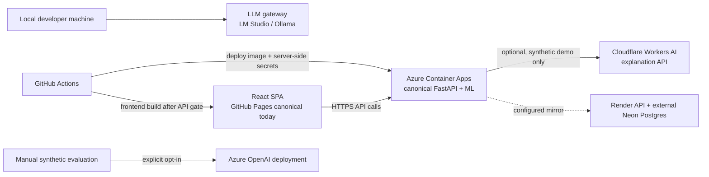

# CreditFlow GenAI, agent, and deployment boundaries

## Cloud topology in this repository

The current frontend is GitHub Pages. Cloudflare Workers AI is an optional
server-side explanation provider; it is not currently the canonical frontend
host. The Render blueprint is a separately configured mirror plane, not an
automatic failover target. Azure Container Apps is the canonical API deployment.
Do not configure browser code to call LLM providers directly or embed a shared
API key in the static frontend.

## Data and provider policy

| Data class | Allowed inference path | Public LLM behavior |
|---|---|---|
| `CONFIDENTIAL` (default for application state) | Deterministic explanation or configured private/local provider | Blocked by the existing policy guard |
| `PUBLIC_SYNTHETIC` fixed portfolio fixtures | Deterministic/local path; optional manually enabled Cloudflare/Azure judge | Allowed only in the explicit evaluation command; never use arbitrary applicant data |

Provider failure returns the deterministic explanation. Do not add silent
cross-provider fallback: a fallback can change where sensitive data is sent.
Secrets belong in Azure Container Apps secrets, Render dashboard secrets, or a
local ignored `.env`; never in source, logs, model-card output, or the browser.

## Domain agent responsibilities

CreditFlow already has specialist subagents connected to its LangGraph workflow.
Keep them narrow and deterministic where they own controls:

| Agent | Domain responsibility | May do | Must not do |
|---|---|---|---|
| `UnderwritingRiskAgent` | Input validation, tabular score, financial features | Invoke the versioned model and compute derived ratios | Let an LLM set a probability or threshold |
| `FraudComplianceAgent` | Gateway checks, deterministic fraud signals, policy rules | Escalate policy/fraud concerns to review | Treat an LLM answer as a fraud finding or regulatory conclusion |
| `ExplainabilityAgent` | Explain an already-computed result | Produce guarded, grounded explanation fields | Change decision, risk score, or human approval state |
| `DisbursementExecutionAgent` | Decision routing, human interrupt, execution stub, audit | Continue only through the configured state graph and authorization checks | Let a conversational agent bypass authorization or human review |

There is no separate free-form conversational agent in the current product.
The workflow specialists are the domain-fit agents. Any future analyst assistant
should be a read-only helper over a case and approved policy documents, with no
approval, threshold, ledger-write, or disbursement tools.

## LLM judge protocol

Run `python scripts/eval_explanations.py --llm-judge` only when intentionally
evaluating the checked-in synthetic fixtures. The default judge provider is
Cloudflare Workers AI. Its default judge model is
`@cf/meta/llama-3.3-70b-instruct-fp8-fast`, requested in JSON Mode with a score schema;
the optional explanation provider may use a different model. To compare a
larger Azure-hosted judge model, set
`AZURE_OPENAI_ENDPOINT`, `AZURE_OPENAI_API_KEY`, and
`AZURE_OPENAI_JUDGE_DEPLOYMENT`, then pass `--judge-provider azure-openai`.
The deployment name is supplied with `--judge-model` when needed. These values
must remain in the local environment or secret store.

The judge returns advisory 1–5 scores for grounding, completeness,
actionability, and decision-boundary discipline, plus issues and a suggested
prompt revision. It does not alter the prompt, model, score, threshold, or
decision. Save the generated evaluation JSON for comparison, review proposed
prompt edits manually, then rerun the same fixtures. A judge score is not a
credit-risk metric or proof that an explanation is faithful; deterministic
numeric-grounding checks and human review remain separate.

On 2026-11-03, a live Cloudflare call using three fixed synthetic profiles
returned schema-valid scores in all three cases. Mean advisory scores were
grounding 4.00, completeness 4.67, actionability 4.00, and decision-boundary
discipline 2.67 (each on a 1–5 scale) with the prior 8B judge. A controlled
contrast then compared a review-safe explanation against one with fabricated
income and automatic approval, plus an incomplete explanation. The 8B model
ranked only 2 of 4 expected defect comparisons correctly in one run. The 70B
model ranked all 4 correctly in each of two runs (8/8) and is now the default
for this manually invoked evaluation. Reproduce the contrast with
`python scripts/benchmark_llm_judge.py --live --repeat 2 --output <path>` after
configuring Cloudflare credentials. The 70B model has a higher per-token price
than the 8B model; see the [Cloudflare model pricing](https://developers.cloudflare.com/workers-ai/models/llama-3.3-70b-instruct-fp8-fast/).
These small constructed cases do not measure agreement with independent human
ratings or real-world explanation quality.

## Model monitoring and escalation

`GET /drift` measures input and prediction distribution PSI. It does not measure
loss, approval quality, calibration drift, or fairness. Current PSI bands are
`<0.10`, `0.10–0.20`, and `≥0.20`; the model card proposes manual responses for
those bands. Those responses are governance guidance, not an automated circuit
breaker implemented in the API.

When delayed labels become available in a properly governed evaluation dataset,
report ROC-AUC, PR-AUC, KS, Brier/ECE, operating-point outcomes, and error rates
over time. A reviewer must approve any model or policy change; no LLM judge is
part of that approval gate.
